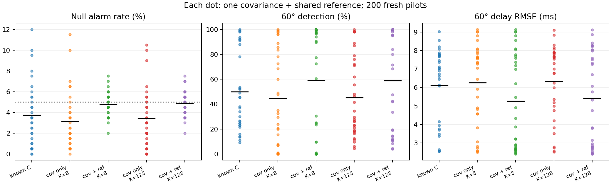

# Shared reference and optical-delay measurement

A 45–60 minute integrated lab: what happens when an instrument stores one noisy reference and reuses it for hundreds of decisions? This extends the fixed-calibration lesson with shared-reference dependence, keeping the physical model fixed to isolate this new error source.

## Learn and run

Prerequisites: Gaussian PSFs, covariance, least squares, conditional probability and Python. Learn pixel-integrated spot formation, subpixel optical-delay recovery, shared-reference dependence and conditional threshold calibration.

```sh
git clone https://github.com/ahmetalpkilic/shared-reference-optical-delay-learning-lab.git
cd shared-reference-optical-delay-learning-lab
sh run_demo.sh
```

Python 3.9–3.12; initial installation needs internet. The command creates a virtual environment, runs tests and generates examples/results.json and examples/batches.png. Seed 20261022, pinned dependencies, synthetic data only; cross-platform last-bit differences are possible. Suggested hour: 10 minutes predict, 10 run/inspect, 15 derivation, 15 code, 10 exercises.

## Four-way connection

| Area | Forward model | Measurement connection |
|---|---|---|
| Optics | Fourier transform of a 550 nm Gaussian pupil | Known diffraction PSF determines spot profile |
| Camera | 16 mm focal length, 4 µm integrated pixels, read noise | Nonlinear subpixel spot fit |
| Vision/metrology | Known 0.8 px/s motion, two timestamp channels | Recover 120 ms delay with alarm-selected GLS weights |
| Mathematics | Shared random reference, conditional ranks, total variance | Derive alarm clustering and quantify delay sensitivity |

## Physical model and conventions


Use an untruncated paraxial Gaussian pupil amplitude `P(r)=exp(-r²/a²)`. Fourier transformation and intensity squaring yield

`σ_sensor = λ f/(2πa)`, `σ_px = λ f/(2πap) ≈ 0.35014 px`.

This is an infinite-support apodized pupil, not a hard circular aperture. No Airy diameter or hard-aperture f-number is substituted. Positive image x points right; integer pixel centers run −16…16, with boundaries j±0.5. The 33×33 camera has zero skew/distortion and intrinsics `K_camera=[[4000,0,16],[0,4000,16],[0,0,1]]` in zero-based array coordinates. We use the 1-D marginal of the separable 2-D PSF; calibration size below is called K and is unrelated to camera intrinsics.

For known total marginal flux F=10000 signal units and background b=20 units/pixel,

`μ_j(c)=b+F[Φ((j+0.5−c)/σ)−Φ((j−0.5−c)/σ)]`.

Independent Gaussian read noise has SD 2 signal units/pixel. Shot noise, quantization, saturation and exposure integration are omitted. Flux here is an idealized signal amplitude, not a claim of photon-limited sensing. Fit c by least squares with known F, b, σ; analytic derivatives are checked against finite differences. With known `c0=.23 px`, `v=.8 px/s`, true delay `.12 s`, center is `.326 px`. Optical time is `(c_hat−c0)/v`. Fits outside the ±6 px ROI are rejected.

## Timing model and alarm score

The event reference time is zero. Timestamp errors are `e_t=s Qθ x_t`, s=.02 s, where Q is a counterclockwise 2-D rotation and two independent stationary AR modes have correlations ρ=(0,.85). Recursion: `x_t=ρ x_(t−1)+sqrt(1−ρ²)z_t`, z standard normal. Each trace starts in stationarity. Thus `C=s²I` and `Γ_h=s²Qθ diag(ρ^h)Qθᵀ`. Physical channel labels remain fixed. Old traces have θ=0; pilots have θ=0 or 60°. Every trace contains n=96 observations.

From K=8 or 128 independent reset observations, estimate `C_hat=Σ(z_i−z_bar)(z_i−z_bar)ᵀ/(K−1)` in s². These are not consecutive AR samples. Each batch gets one independent C_hat, held fixed for all 200 null and 200 alternative test events. One old null reference trace is generated per batch and reused for all null and alternative events. Only pilots are newly generated per event. No sliding windows are used.

A centered dimensional symmetric lag estimate is

`G=[Σ(e_t−e_bar)(e_(t+1)−e_bar)ᵀ + transpose]/(2n)`.

Set `W=C_hat^(−1/2)` using a symmetric eigendecomposition; score `D=||W(G_pilot−G_old)Wᵀ||_F`. W has units 1/s, so D is dimensionless. The same W acts on both traces. Non-positive eigenvalues are rejected without an implicit ridge. An unbiased C_hat does not make its inverse unbiased. Scalar error is especially transparent: replacing C_hat by a C_hat divides every score by a.

`lab.py:sequences` vectorizes independent AR traces; `lag_batch` centers each trace separately. `score` broadcasts one fixed W across a batch. Tests compare these operations with the predecessor's scalar implementations.

## Derive shared-reference dependence

Let R be the estimated lag matrix of the single old reference, P_i the independent pilot lag matrix, and d_i=vec(P_i−R). At fixed independent C_hat, for i≠j,

`Cov(d_i,d_j | C_hat)=Cov(vec(R))`.

Expanding Cov(P_i−R,P_j−R), independence removes all terms except Cov(R,R). Whitening transforms this covariance to `A Cov(vec(R)) Aᵀ`, where `A=W⊗W` for column-major vectorization of W(P_i−R)Wᵀ. The scalar special case d_i=u_i−r gives Cov(d_i,d_j)=Var(r), independently tested.

Alarm indicators are nonlinear. For covariance-only training, fix C_hat and its independently trained threshold T. Define p(R)=P(D_i>T | C_hat,R,T). Fresh pilots make alarms independent conditional on R, but the law of total covariance gives

`Cov(A_i,A_j | C_hat,T)=Var_R[p(R) | C_hat,T]`.

For full conditioning, T depends on R through training. Use joint batch state H=(C_hat,R,T) instead: `Cov(A_i,A_j)=Var_H[p(H)]`. Even true known C does not remove reference variability.

## Controlled conditioning experiment

Each of 32 batches has one reference, one calibration for each K=8/128, 999 training scores, and 200 null plus 200 alternative events. Policies share held-out pilots, reference, final clocks and optical images.

- **known:** true C with a global threshold trained on fresh independent null pilot/reference pairs. Deployment still shares R. This is the reference-variability control without covariance estimation.
- **cov-only:** fix C_hat, train with fresh null pilot/reference pairs. This averages over references instead of conditioning on the deployed R.
- **cov+ref:** fix both C_hat and deployed R; train on fresh null pilots minus this same R. This matches the conditional deployment distribution.

Use strict exceedance of the 950th sorted score among 999: ceil((999+1)*.95). Exchangeability under the exact continuous null simulator gives a 50/1000 false-alarm probability. Cov-only guarantees average over new references and training. Cov+ref guarantees condition on C_hat and R but still average over training randomness. Neither guarantees exactly 5% for one fitted threshold or controls the chance of any alarm in a batch.

Annotated core: lab.py:reference_differences freezes R; run separates the two training distributions; score applies common whitening. optics.py supplies integrated pixels and an analytic derivative; model.py supplies AR traces, finite-repeat covariance and GLS weights.

Seven disjoint RNG streams separate global training, batch covariance, conditional training, old references, held-out pilots, final clocks and camera noise. Conditional policies use separate fresh training draws, shared across K within each policy. Reference reuse is deliberate; held-out pilots never enter training. Only the known policy shares a global threshold across batches.

## Quantify batch variation

Given H=(C_hat,R,T), A_b is Binomial(B,p_b) with B=200, because pilots are fresh. For r_b=A_b/B,

`Var(r_b)=Var(p_b)+E[p_b(1−p_b)]/B`.

Estimate the second term without bias by mean[r_b(1−r_b)/(B−1)] and subtract from sample variance of r_b. Retain negative residuals from finite Monte Carlo noise. The JSON's estimated_between_batch_variance includes covariance, reference and threshold variation; it does not isolate reference variance alone. Cluster MCSE is SD(r_b)/sqrt(32), conditional on the known policy's global training. Treating 6400 alarms as independent misses batch dependence. Observed 10–90% ranges include binomial noise and are descriptive, not confidence limits.

## Connect alarms to optical-delay error

An alarm chooses known 60° GLS weights instead of known 0° weights. Only the detector covariance is estimated: timing modes and corrective direction are assumed known. For m=32 consecutive stationary final repeats, independent of pilot/calibration, covariance of their mean is

`Vθ=(s²/m²)Qθ diag[m+2Σ_(h=1)^(m−1)(m−h)ρ^h]Qθᵀ`.

There are m diagonal covariance terms and 2(m−h) terms at lag h in the double sum, deriving this expression. Minimize wᵀVw subject to wᵀ1=1 by a Lagrange multiplier to get `w=V^(−1)1/(1ᵀV^(−1)1)`. The delay estimator is `τ_hat=(c_hat−c0)/v−wᵀe_bar`.

Actual camera fits and final clock sequences are simulated. Reports include total squared delay error in ms² and exact conditional clock variance `10^6 wᵀVθw`. The latter excludes optical noise; it is a numerical validation reference, not an accuracy certificate. Under the null an alarm can choose harmful weights. Higher detection alone is therefore not sufficient. Pooled RMSE is `sqrt(mean(batch MSE))`, not mean(batch RMSE). Plot horizontal marks are means of the plotted batch values.

## Expected results

These are the committed seed's outputs, not targets used for threshold tuning.

| Policy | K | Null mean / batch 10–90% | 60° detection mean / batch 10–90% | 60° pooled delay RMSE |
|---|---:|---:|---:|---:|
| known | known | 3.75% / 0.50–7.95% | 50.03% / 14.20–97.55% | 6.452 ms |
| cov-only | 8 | 3.14% / 0.50–6.50% | 44.45% / 0.05–97.40% | 6.629 ms |
| cov+ref | 8 | 4.78% / 3.50–6.00% | 59.17% / 0.00–100.00% | 5.839 ms |
| cov-only | 128 | 3.42% / 0.50–6.45% | 45.28% / 11.60–97.10% | 6.634 ms |
| cov+ref | 128 | 4.88% / 3.50–6.00% | 58.80% / 10.55–100.00% | 5.948 ms |



Full conditioning tightens null batch-rate ranges in this realization. It does not stabilize all alternative detection: K=8 detection spans 0–100% across the middle 80% of batches. Delay RMSE improves here, but 32 batches and one training seed do not establish universal improvement or significance. Cov-only null means below 5% are retained: the rank result averages over new references and training, not this finite reference set. Known C also shows wide detection variation, isolating reference sensitivity without covariance error. Plot black marks average plotted batch values; the last panel's mean batch RMSE differs from pooled RMSE in the table.

## Validation and exercises

The 22 inherited tests cover optical flux, derivatives, noiseless recovery, stationary timing covariance, finite-repeat variance against a double sum and Monte Carlo, GLS optimality, whitening, affine invariance, singular rejection, rank arithmetic and binomial-mixture variance. Four new tests check exact frozen-reference subtraction, common translation across events, cross-event covariance against an independent scalar special case, and conditional rank calibration for an extreme fixed scalar reference. Tests do not demand a favorable demo result.

1. Increase events per batch to 800. Predict which variance component decreases and why reference heterogeneity persists.
2. Increase only reference length from 96 to 384, leaving pilots unchanged. Predict reference covariance and detection spread; edit only the reference generation call.
3. Redraw the old reference per held-out event and use covariance-only training. Explain why this recovers the predecessor's conditioning structure.
4. Double pixel pitch or read noise. Derive the new spot sampling/localization error and compare total delay MSE with the clock-only reference.
5. Run several complete seeds, including training. Compare paired batch MSE differences; do not interpret one lower RMSE as universal superiority.

## Limitations and next experiment

Numerical recovery is not instrument accuracy. Exact-null-simulator benchmark with known PSF, photometry, motion, timing dynamics and corrective direction. Instantaneous exposures, read noise only, no shot noise, quantization, saturation or hardware validation. Only 32 batches; conditional training costs 999 fresh null pilots per batch. Gaussian pupil has infinite support; a hard-aperture f-number does not apply. Per-event guarantees are not familywise guarantees. No general online learner.

Next focused lesson: average 1, 4 or 16 independent old reference traces, holding pilots and calibration fixed. Derive the 1/L reference covariance reduction and compare conditional alarms and optical-delay risk. Distinguish independent averaging from lengthening correlated traces.

## Attribution

ATTRIBUTION.md and sources.json record reuse, exact current source commits/activity and licenses. Full license snapshots are in provenance/. PREDECESSOR.md and PREDECESSOR_ATTRIBUTION.md describe historical experiments; this README and lab.py define the current lesson.
